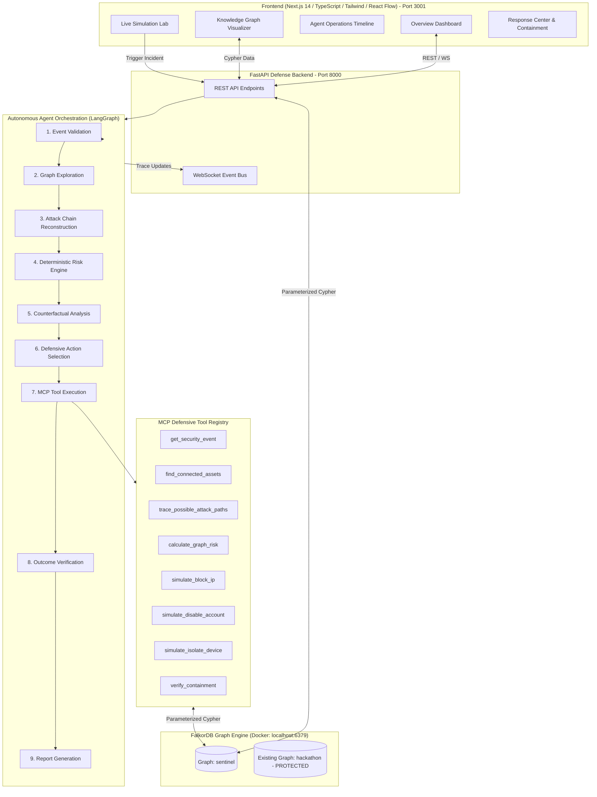

# SENTINEL Architecture Specification

## 1. Executive Summary

**SENTINEL** is an autonomous defensive cybersecurity agent designed for **Track 1: Agents That Act on Connected Data** of the WeMakeDevs &times; FalkorDB Graph Hacks Hackathon.

Traditional security information and event management (SIEM) systems treat security telemetry as isolated tabular events, producing alert fatigue and missing complex multi-hop lateral movements. SENTINEL utilizes **FalkorDB** as its persistent, low-latency graph intelligence foundation, enabling an autonomous agent to:
1. Reconstruct multi-hop attack paths leading to sensitive "Crown Jewel" assets.
2. Separate confirmed observed activity from inferred exposure paths.
3. Compute evidence-grounded risk scores using deterministic graph mathematics.
4. Perform **Counterfactual Containment Analysis** (evaluating risk before vs after simulated mitigation).
5. Execute permitted simulated containment actions via the Model Context Protocol (MCP).
6. Verify the containment in the graph state and generate an explainable forensic incident report.

---

## 2. System Architecture Diagram



---

## 3. Core Component Workflows

### 3.1. Telemetry Ingestion & Graph Mapping
When a security event occurs (e.g., Okta anomalous authentication, EDR lateral movement, CloudTrail IAM escalation), it is recorded as a `:SecurityEvent` node and linked to the originating entity (`:User`, `:Device`, or `:IPAddress`) via `[:GENERATED_EVENT]` and `[:LOGGED_IN_FROM]`.

### 3.2. Multi-Hop Graph Traversal
Instead of analyzing the event in isolation, the agent executes Cypher traversals up to 4 hops deep:
```cypher
MATCH (origin {id: $source_id})
MATCH path = (origin)-[:LOGGED_IN_FROM|CONNECTED_TO|HAS_ACCESS_TO|HOSTS|DEPENDS_ON*1..4]->(target)
WHERE target:Database OR target.criticality IN ['CRITICAL', 'HIGH']
RETURN path
```
This discovers whether an entry point has a viable lateral path into Crown Jewel assets (e.g., PostgreSQL databases storing customer PII or tokenized PCI payment card caches).

### 3.3. Deterministic Risk Engine
Risk is computed deterministically rather than fabricated by an LLM:
$$\text{Risk} = (S_{\text{base}} \times 0.25) + (C_{\text{assets}} \times 0.30) + (P_{\text{prox}} \times 0.15) + (E_{\text{priv}} \times 0.15) + (K_{\text{conf}} \times 0.15)$$
- **$S_{\text{base}}$**: Base severity of the initial alert.
- **$C_{\text{assets}}$**: Number and criticality of reachable crown jewels.
- **$P_{\text{prox}}$**: Minimum hop distance (proximity) to the crown jewels.
- **$E_{\text{priv}}$**: Privilege escalation level (e.g., Administrator / Root).
- **$K_{\text{conf}}$**: Confidence multiplier of the telemetry log.

### 3.4. Counterfactual Containment Analysis (Differentiator B)
Before executing a simulated containment action, SENTINEL simulates what the graph topology would look like if the candidate entity is blocked or isolated. It computes:
$$\Delta\text{Risk} = \text{Risk}_{\text{before}} - \text{Risk}_{\text{after}}$$
Showing the security team exactly how many attack paths will be severed.

### 3.5. Model Context Protocol (MCP) Execution
The agent invokes simulated containment tools:
- `simulate_block_ip`: Drops traffic from external attacker IPs in perimeter firewalls.
- `simulate_disable_account`: Suspends compromised synthetic identities and invalidates active sessions.
- `simulate_isolate_device`: Quarantines endpoint network interfaces via EDR.

All actions are persisted as `:DefensiveAction` nodes, linked to the `:Investigation` in FalkorDB, and provide full one-click rollback capabilities.
